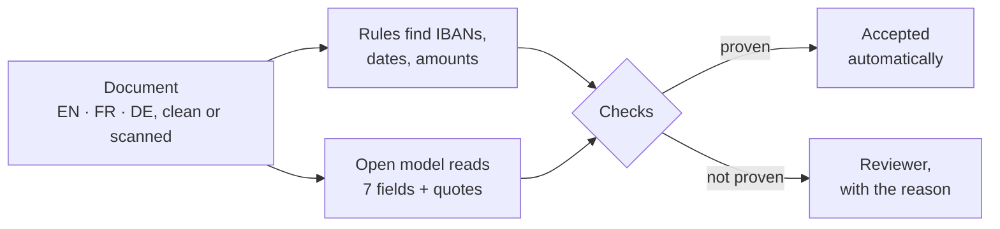

# Finance document agent

Reads invoices, payment requests and contracts in English, French and German, and accepts a field only
when the code can prove it. Everything else goes to a person, with the reason.

[](https://github.com/i-teamcollage/finance-document-agent/actions/workflows/acceptance.yml)


> A working sample by [I-Team Collage](https://iteamcollage.com). It runs on a free, open model on a
> laptop and reads made-up documents. Nothing in this repository comes from a client.

## What it does

A back office pays from seven fields: who is paid, the document number, two dates, the amount and the
bank details. One wrong digit in an IBAN sends money to the wrong account, so this agent does not trust
its own reading.

For every field, the model has to quote the exact text it read. The code then checks everything a careful
clerk would:

- the IBAN's check digits;
- the bank behind the IBAN;
- the account on file for that supplier;
- totals that add up;
- dates that match their quote.

A field that passes is accepted. A field that does not goes to a reviewer with the reason, and with a
suggested correction when the problem looks like a scan error.



## Results

The acceptance test was written before the agent was built. It runs on 80 made-up documents the agent
was never tuned on.

<!-- results:start -->
| Criterion | Target | Measured | 95% interval | Result |
|---|---|---|---|---|
| Bank details accepted automatically that are correct | ≥ 99% | 100.0% | 97.2–100.0% | PASS |
| All fields accepted automatically that are correct | ≥ 98% | 100.0% | 99.3–100.0% | PASS |
| Fields found correctly, whether accepted or sent to review | ≥ 95% | 98.9% | 97.7–99.5% | PASS |
| Documents fully processed with no human touch | ≥ 70% | 70.0% | 59.2–78.9% | PASS |
| Trap documents sent to review | = 100% | 100.0% | 67.6–100.0% | PASS |

80 made-up test cases, ministral-3:8b on Apple M4, 16 GB, recorded 2026-10-06, median 28.2 s per item.
<!-- results:end -->

A document that does not go straight through reaches a reviewer with a stated reason: scan damage in a
bank detail or a document number, a trap, or a supplier missing from the vendor master.

The trap documents are the point of the test. Every one of them must reach a person:

- an IBAN with wrong check digits;
- an account that differs from the one on file, which is how payment-diversion fraud usually looks;
- a BIC from another bank;
- totals that do not add up;
- a due date before the invoice date.

Full results, per field, are in [reports/acceptance.md](reports/acceptance.md).

## How this compares to the client build

The production version of this agent runs in a regulated finance back office. On the client's own
documents it measured:

- about 99% precision on banking details;
- above 95% recall across the tracked entity types;
- a target 90% reduction in processing time.

It is integrated into the existing back office through an API and a review screen. Those figures come
from client data and cannot be reproduced here. The numbers above are this sample's own.

A client build adds:

- real OCR for scans (this sample simulates scan errors in text);
- the official SEPA and SWIFT bank directories instead of a small fictional one;
- your vendor master and your ERP;
- a review screen and an audit log of every decision;
- a fine-tuned entity model for organisations and document numbers, as in the client build;
- deployment in the EU or on your own servers.

## Try it in a minute

No model and no packages are needed. The repository stores one real run, and replaying it re-runs all of
the agent's own code (rules, checks, scoring) against the model's recorded answers.

```bash
git clone https://github.com/i-teamcollage/finance-document-agent
cd finance-document-agent
make demo      # three documents, explained
make accept    # the full acceptance test
```

You need Python 3.11 or newer, nothing else.

## Run it live

1. Install [Ollama](https://ollama.com), then pull the model: `ollama pull ministral-3:8b`. It is a 6 GB
   download, made by Mistral AI and licensed under Apache 2.0.
2. `make live` runs the acceptance test against the model. `make record` also stores the run.
3. Read one of your own documents:
   `PYTHONPATH=src python -m finance_document_agent run path/to/document.txt`

## How it works

| File | What it does |
|---|---|
| [`rules.py`](src/finance_document_agent/rules.py) | Plain rules find IBAN-like strings, BICs next to their label, dates, amounts and document numbers. They are hints for the model and a second opinion for the checks. |
| [`extract.py`](src/finance_document_agent/extract.py) | One model call per document. The answer is held to a JSON schema: each field plus the exact text it came from. An invalid answer gets one retry, then goes to a person. |
| [`checks.py`](src/finance_document_agent/checks.py) | The confidence line. Each field is accepted only if every check passes; otherwise it is sent to review with the reasons. |
| [`banking.py`](src/finance_document_agent/banking.py) | IBAN check digits (ISO 13616), country formats, the bank directory, and single-character scan repairs. |
| [`parsing.py`](src/finance_document_agent/parsing.py) | Dates, amounts and payment terms in English, French and German, tolerant of scan errors such as `2O26` or `l4 Tagen`. |
| [`vendors.py`](src/finance_document_agent/vendors.py) | The vendor master: supplier names matched without legal form, accents or scan errors. |
| [`llm.py`](src/finance_document_agent/llm.py) | Talks to Ollama with the standard library. Every call is fingerprinted, so a stored run replays exactly or stops with a clear message. |
| [`acceptance.py`](src/finance_document_agent/acceptance.py) | Reads the thresholds in [`acceptance.toml`](acceptance.toml), prints PASS/FAIL with 95% intervals, and writes the reports and the table above. |

Design choices:

- **The model never has the last word on a format-bound field.** IBANs, BICs, dates and amounts are
  re-read from the model's own quote by deterministic code, and the two readings must agree.
- **A repaired IBAN is a suggestion, never an acceptance.** The repair is offered to the reviewer.
- **New suppliers always go to a person.** Their bank details cannot be checked against anything.
- **Every call uses temperature 0 and a fixed seed,** and the stored run makes the results repeatable
  on any machine.

## About the data

[`data/generate.py`](data/generate.py) writes every document from fixed seeds and the repository's own
word lists, without Faker, so the documents never change unless the generator does.

- 40 practice documents and 80 test documents. Tuning happens on the practice split only.
- 30% are simulated scans. They have misread characters (2% of the characters a scanner confuses, such as
  O and 0, or l and 1), merged columns, stray marks, and a scan date at the top that is not the document
  date.
- 10% are trap documents. Another 5% come from suppliers missing from the vendor master.
- A vendor master of 45 suppliers and a directory of 14 banks.

Every company, person and bank is fictional, and any resemblance is a coincidence. The IBANs have valid
check digits for the fictional banks; they are not real accounts.

---

Built by [I-Team Collage](https://iteamcollage.com): workflow automation for finance, operations and
support teams in Europe, accepted only when it passes a test your own people wrote.
[Book a free 30-minute call](https://calendly.com/dorsa-maskouki/i-team-collage).

Licensed under the [MIT License](LICENSE).
